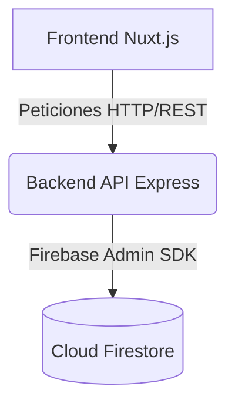

# Arquitectura del Sistema

## Frontend (Interfaz de Usuario)
### Desarrollado en Nuxt.js. 
* Es responsable de la presentación de datos, la recolección de entradas del usuario y la validación inicial. 
* Se comunica exclusivamente con la API, separando la interfaz de las reglas de negocio. 

## Backend (API / Reglas de Negocio)
### Desarrollado en Node.js con Express.
* Centraliza la lógica de negocio (evitar duplicados, validaciones de entrada seguras, estimación de tiempos)

## Persistencia (Base de Datos)
### Firebase Cloud Firestore
* Almacena de manera centralizada las entidades de negocio. 
* No recibe peticiones directas de los clientes por motivos de seguridad.
