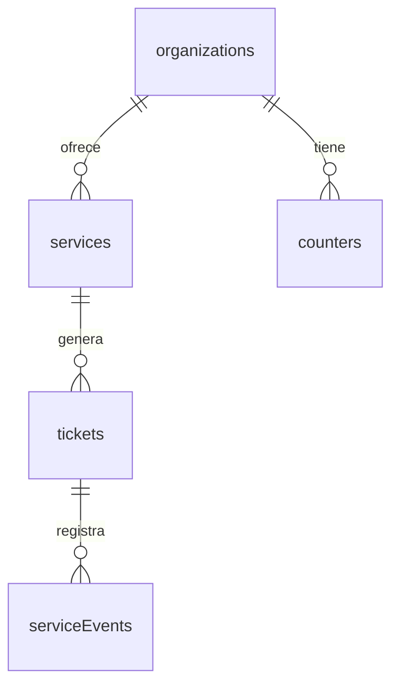

# Modelo de Base de Datos (Firestore)

## Explicacion de diagrama de flujo
Como se muestra en el diagrama anterior, esta es la configuracion de la cual se basa princiapelmente el modelo de la base de datos de FIREBASE, a continuacion se explicara las KEYWORDS marcadas: 

* organizations: Datos del establecimiento.
   *  id (string), name (string).

* services: Catálogo de trámites.
    * id (string), name (string), prefix (string, ej. "CJ"), isActive (boolean).

* counters: Módulos o ventanillas.
    * id (string), name (string, ej. "Módulo 1"), supportedServices (array de strings).

* tickets: Turnos emitidos.
    * id (string), serviceId (string), number (number), displayCode (string, ej. "CJ-001"), status (string: pending, calling, in-progress, completed, canceled), createdAt (timestamp).

* serviceEvents: Historial de cambios de estado para métricas.
    * id (string), ticketId (string), status (string), timestamp (timestamp), operatorId (string).

* dailyStats: Acumulados para el estimador de espera.
    * date (string YYYY-MM-DD), serviceId (string), averageWaitTime (number).

## Explicacion de seguridad
Con respecto a las reglas de FIREBASE (docuemnto "firestore.rules") están configuradas para retornar false a cualquier intento de lectura o escritura directa desde el frontend. Para cumplir con la restricción técnica del proyecto de separar interfaz, reglas de negocio y persistencia, toda la manipulación de datos debe pasar obligatoriamente por la API en Express utilizando el Firebase Admin SDK, este mismo ignora estas reglas por ejecutarse en un entorno de servidor confiable.
